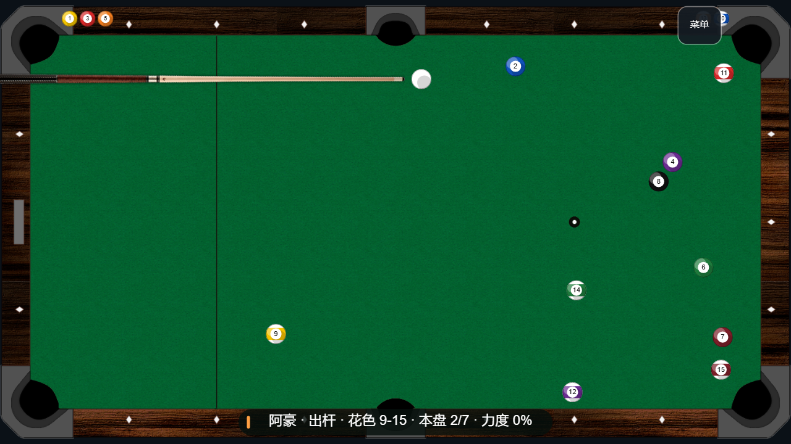

# 经典 8 球台球 · 微信小游戏版

把 [henshmi/Classic-Pool-Game](https://github.com/henshmi/Classic-Pool-Game)（MIT）搬到微信小游戏的完整工程：
去掉全部浏览器 DOM 依赖、界面汉化、接入微信广告，并额外实现了**好友联机对战**和**标准 8 球外观**（实心/花色 + 球号）。



## 特性

- **纯 Canvas 2D 渲染**，固定 1500×825 设计分辨率，等比缩放 + letterbox 适配任意手机横屏
- **真实物理**：原版的碰撞解算与旋转传递，帧率无关的 `DELTA` 步进
- **标准 8 球规则**：开局摆球、犯规判定（未碰目标球/白球落袋/无球碰库）、自由球、黑 8 定胜负
- **人机对战**：AI 用分帧训练（主线程单帧阻塞 < 70ms），三档难度
- **好友联机**：WebSocket 房间服务，房主开局、按服务器快照裁决
- **触屏操作**：按住拖动瞄准 → 拉离白球蓄力 → 松手击球，轻点取消
- **适配细节**：右上「菜单」按钮自动避让系统胶囊与球袋；切后台回来不死循环；诊断面板默认关闭
- **浏览器可玩**：自带 `wx` API 模拟层，游戏代码一行不改就能在桌面浏览器跑

## 目录结构

```
├── classic-pool-minigame/      # 小游戏工程本体（导入开发者工具选这个目录）
│   ├── game.js                 # 入口：按顺序 require 所有模块
│   ├── game.json               # 小游戏配置（横屏 + pkgAssets 分包）
│   ├── src/
│   │   ├── Game.js             # 主循环 / 主菜单切换 / watchdog
│   │   ├── GameWorld.js        # 球桌、球、球杆与碰撞
│   │   ├── Canvas2D.js         # 画布适配、坐标换算、胶囊位置
│   │   ├── AI/                 # 人机对战（分帧训练）
│   │   ├── input/              # 触摸 → 鼠标抽象层、按钮状态
│   │   ├── menu/               # 主菜单 / 按钮
│   │   └── system/             # 广告、音频、昵称、联机、诊断
│   ├── pkgAssets/              # 分包资源（贴图 / 音频）
│   └── README-移植说明.md       # 移植细节、真机坑位、备案要点
├── pool-server/                # 联机房间服务（Node.js + ws）
├── web-preview/                # 浏览器预览层（wx API 模拟）
├── serve.js                    # 预览服务器
├── verify-preview.js           # 渲染/操作端到端验收
└── test-*.js                   # 冒烟 / 自由球 / AI / 昵称测试
```

## 快速开始

### 1. 微信开发者工具

1. 装[稳定版开发者工具](https://developers.weixin.qq.com/miniprogram/dev/devtools/download.html)
2. 「导入项目」→ 目录选 **`classic-pool-minigame`**（不要选它的上级目录）
3. AppID 填自己的小游戏 AppID；没有就先点「测试号」
4. 编译即可运行

### 2. 浏览器预览（不用装开发者工具）

```bash
npm install
node serve.js                      # 打开 http://localhost:5180/
```

鼠标模拟手指：**按住拖动瞄准 → 拉远蓄力 → 松手击球**。

### 3. 联机服务

```bash
cd pool-server && npm install && node index.js    # ws://127.0.0.1:3010/pool
```

预览层会自动把 `wss://` 地址改写成 `ws://本机:3010`，本地联机不用改代码。开两个标签页，都用「好友对战」，一个建房一个输码加入。

## 测试

```bash
node verify-preview.js    # 端到端验收：渲染 / 点击 / 击球 / HUD / 菜单避让
node test-smoke.js        # 冒烟：启动 → 进对局 → 击球 → 暂停 → 继续
node test-freeball.js     # 自由球摆放规则
node test-ai.js           # AI 分帧训练不阻塞主线程
```

## 使用前需要替换的三处

| 位置 | 现在的内容 | 说明 |
|---|---|---|
| `project.config.json` → `appid` | 作者的 AppID | 换成你自己的小游戏 AppID |
| `src/Global.js` → `SERVER_URL` | 作者的联机域名 | 换成你自己的、且已完成 ICP 备案并加到 socket 合法域名 |
| `src/system/Ad.js` → `AdConfig` | `adunit-请替换...` 占位符 | 换成流量主后台的真实广告位 ID；不换则广告模块空转，不影响游戏 |

## 说明

- 诊断面板（`src/system/Diagnostics.js`）**默认关闭**。真机排查时用 `wx.setStorageSync("diag_on", 1)` 打开。
- 小游戏上线需要完成**小游戏备案 + 小程序备案（ICP）**，纯广告变现（IAA）的个人主体不能开虚拟支付。细节见 `classic-pool-minigame/README-移植说明.md`。

## 许可

MIT。原版由 [Chen Shmilovich](https://github.com/henshmi) 开发，本移植同样以 MIT 发布，详见 [LICENSE](LICENSE)。

游戏内 `© 2018 Chen Shmilovich` 署名与 BGM 的 CC BY 3.0 署名请一并保留——这是原作者的许可条件。
